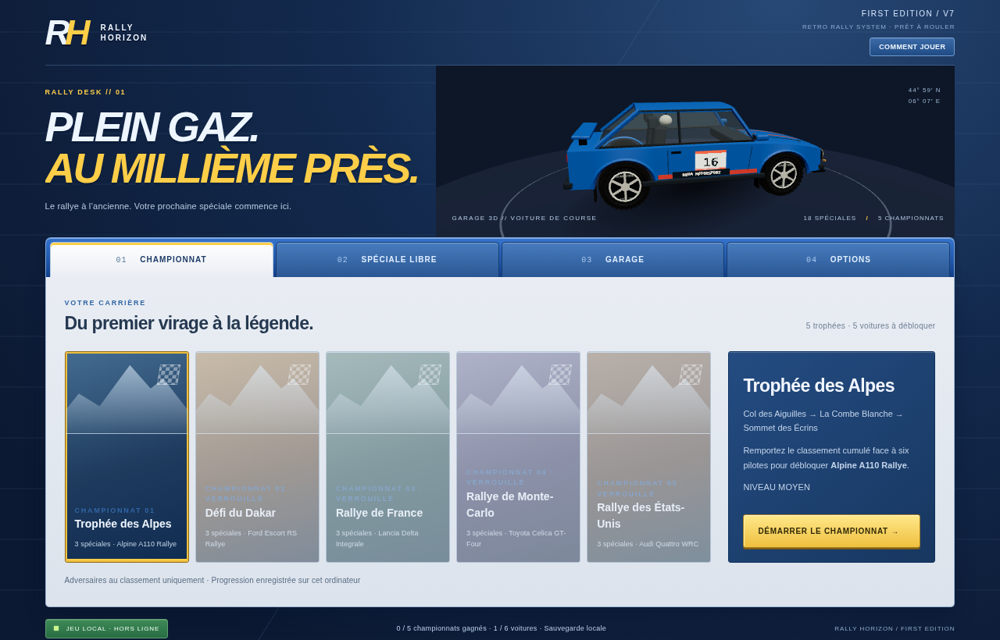
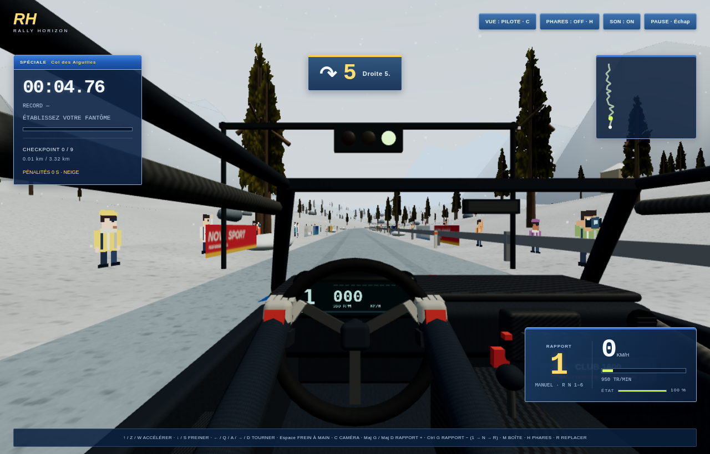
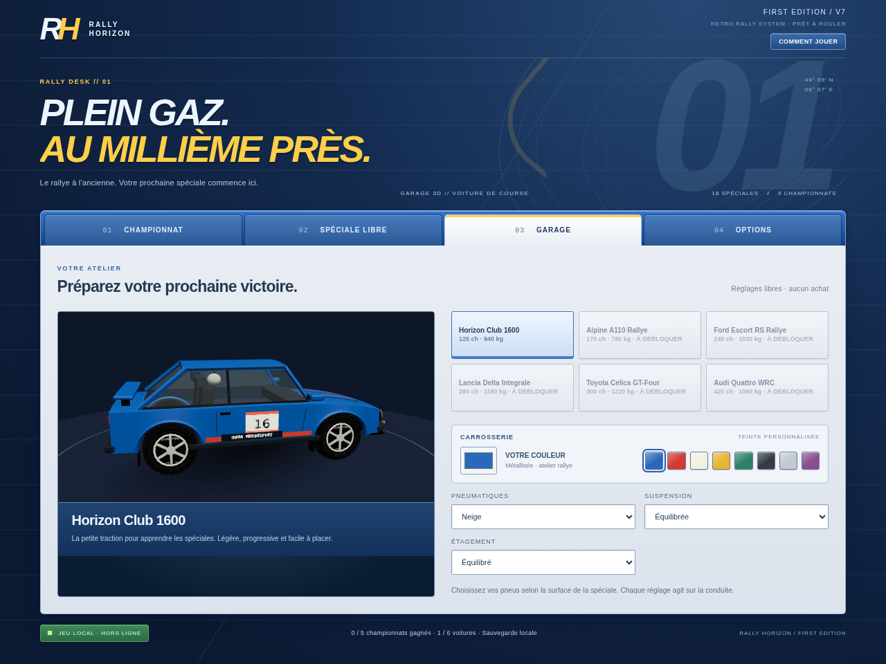

# Rally Horizon — First Edition

Jeu de rallye 3D en français, hors ligne, pour Windows 10/11 x64. Cette édition remplace les boucles par des spéciales de point à point et ajoute carrière, garage, copilote et nouveaux véhicules. Les routes et les modèles sont inspirés du rallye, avec six carrosseries originales profilées et facettées ; il ne s’agit pas de reproductions photographiques ou de parcours géographiques exacts.

Version **7.0 — Retro Rally** : six silhouettes et cockpits distincts, roues facettées placées dans leurs arches, public en sprites pixelisés et flashs photo, sponsors fictifs, interface bleue/argent début 2000, palettes de peinture et affiches de départ. Les dix-huit tracés ont leurs propres enchaînements. La boîte manuelle propose R/N/1–6 et le moteur peut prendre des tours au départ. Cinq difficultés et une reconnaissance Hardcore sans carte ni notes complètent la progression.







## Télécharger et installer

Dans GitHub **Actions → Jeu Windows**, ouvrir la dernière exécution réussie puis télécharger l’artefact souhaité (connexion GitHub nécessaire). Extraire le ZIP avant de lancer le programme.

- **Windows-Installation** : assistant d’installation français, raccourci et désinstallation Windows.
- **Windows-Portable** : jeu sans installation.
- **Navigateur-Hors-Ligne** : fichier HTML autonome à ouvrir dans Edge/Chrome avec WebGL 2 et accélération graphique.

Les téléchargements sont conservés 30 jours. Le workflow peut être relancé dans Actions. Les exécutables ne sont pas signés numériquement ; les contrôles Windows peuvent demander de vérifier l’éditeur. La compilation est réalisée sous Linux avec Electron Builder et NSIS. Les fonctionnalités du jeu sont testées dans Chromium ; le démarrage et l’installation sur un PC Windows restent à vérifier sur cette plateforme.

## Modes de jeu

Le menu principal s’affiche avant la course, avec **Championnat**, **Spéciale libre**, **Garage** et **Options**. Les voitures gagnées et les championnats remportés sont conservés. Les tracés ayant été reconstruits en version 7, leurs anciens chronos sont archivés et un championnat en cours repart du début ; les nouveaux parcours ont leurs propres records et fantômes.

18 spéciales originales d’environ **3,25 à 3,8 km** sont disponibles : neige des Alpes, sable d’Afrique/Dakar, asphalte français, cols de Monte-Carlo, gravier américain et routes sinueuses dégradées de Roumanie. La durée dépend du pilote et de la voiture ; elles sont dimensionnées pour plusieurs minutes, sans attente artificielle à l’arrivée. Les neuf portes après le départ doivent être franchies dans l’ordre. Les barrières, arbres, maisons et rochers peuvent ralentir la voiture lors d’un contact.

Les routes alternent courbes rapides, enchaînements et lacets, avec une largeur réduite par rapport aux versions précédentes. Chaque départ propose le choix de la voiture débloquée, des pneus, de la suspension, de l’étagement et de la boîte et de la difficulté. Les pneus recommandés sont présélectionnés. Les feux passent du rouge au jaune puis au vert ; des spectateurs en sprites pixelisés et des photographes avec flashs accompagnent le départ. Les panneaux affichent des sponsors fictifs créés pour le jeu.

La météo et l’ambiance varient selon la spéciale : neige ou pluie animées, brouillard changeant, poussière, ciel couvert, soleil et une étape nocturne. Les décors comprennent arbres avec troncs et branches en 3D et feuillages texturés sur plusieurs plans croisés, herbe, bâtiments, rochers et garde-corps.

Les cinq championnats sont **Alpes, Dakar, France, Monte-Carlo et États-Unis**, avec trois spéciales chacun. Six adversaires sont représentés par leurs temps déterministes au classement, sans voitures IA sur la route. Le classement utilise les temps cumulés et pénalités. Chaque championnat remporté débloque le suivant et une voiture :

1. Alpine A110 Rallye.
2. Ford Escort RS Rallye.
3. Lancia Delta Integrale.
4. Toyota Celica GT-Four.
5. **Audi Quattro WRC**, récompense finale.

La voiture initiale est la Horizon Club 1600. Les six silhouettes sont désormais originales et cohérentes : compacte, berlinette, classique, hatchback à ailes élargies et deux coupés. Chaque voiture dispose de son propre tableau de bord. Les anciennes sources Trigger Rally restent archivées et attribuées, mais leurs carrosseries ne sont plus utilisées dans le rendu. Ce sont des interprétations visuelles, sans scans ni licence de constructeur. La Roumanie est accessible en spéciale libre. Une course libre ne supprime pas le championnat en cours ; le menu permet de reprendre la prochaine spéciale non terminée.

## Contre-la-montre, médailles et fantôme

Chaque spéciale possède des objectifs **or, argent et bronze**, indiqués avant le départ. Les anciens records obtiennent automatiquement la médaille correspondante. Le résultat détaille les neuf secteurs et signale un nouveau record. En course, le passage d’un checkpoint affiche le secteur et l’écart avec votre record de cette spéciale.

Un passage complet, sans replacement ni changement de réglage de conduite pendant la course, peut enregistrer un **fantôme cyan**. Il reproduit vos positions et votre orientation, sans collision ni son moteur supplémentaire. Il est conservé dans IndexedDB pour la même spéciale, voiture, pneus, suspension, étagement, boîte, difficulté, aide de stabilité et option de dégâts. La couleur de carrosserie et la caméra ne changent pas cette configuration. Le numéro de version des parcours fait aussi partie de la configuration : un ancien fantôme ne roule jamais sur une nouvelle route. L’écart en direct compare votre progression au même point du tracé. Les enregistrements plus lents conservent le meilleur fantôme ; un replacement ou une modification de la conduite annule uniquement l’enregistrement de la tentative en cours.

Les fantômes sont locaux, sans classement en ligne ni compte. Leur enregistrement est limité à quinze minutes par passage ; un stockage indisponible n’empêche pas de jouer. Les temps de carrière restent distincts des données de trajectoire. Un ancien record sans trajectoire reste valable et il faudra effectuer un nouveau passage pour créer un fantôme.

## Manette, aide et difficulté

Les manettes exposées comme **standard** par Windows / Chromium sont prises en charge : stick gauche pour la direction, RT / LT pour accélérer / freiner, A pour le frein à main, RB / LB pour monter / descendre les rapports, Y pour la caméra, X pour replacer, B pour les phares et Start pour la pause. La croix directionnelle et A parcourent les boutons des menus ; LB / RB changent d’onglet. Zone morte, sensibilité et vibrations sont réglables. Les vibrations dépendent du périphérique et de son pilote. Aucun volant à retour de force n’est revendiqué.

Une déconnexion pendant la course met le jeu en pause. Après une pause, relâcher les commandes permet de réarmer la manette et évite une accélération involontaire. Dans le navigateur, un premier clic peut être nécessaire pour activer le son. Les commandes clavier et leur remappage restent disponibles.

Les aides **Détente, Sport et Expert** règlent la correction du lacet dans les glissades. Les cinq difficultés **Super Facile, Facile, Moyen, Dur, Hardcore** règlent le rythme des adversaires, les aides par défaut et la sévérité des dégâts. Le niveau est fixé au départ d’un championnat pour garder le classement cohérent entre ses trois spéciales. En spéciale libre, les aides peuvent ensuite être ajustées séparément. Les dégâts mécaniques optionnels réduisent progressivement la puissance après un contact. Les chocs déforment le devant, l’arrière ou les côtés selon le point d’impact, et peuvent fissurer le pare-brise. À 90 % de dégâts, la spéciale est abandonnée et aucun temps n’est enregistré. Recommencer ou prendre le départ suivant répare la voiture. Les contacts utilisent le volume du châssis et des barrières continues : un frottement conserve la vitesse tangentielle, tandis qu’un choc frontal freine davantage. L’état est visible au tableau de bord. La poussière sur la carrosserie est cosmétique et se nettoie au départ suivant.

En **Hardcore**, chaque spéciale commence par une reconnaissance à l’aveugle : carte, notes et fantôme sont masqués. Le repérage ne produit aucun record, temps de championnat ou récompense. Après les neuf checkpoints, choisir **Refaire une reconnaissance** ou **Lancer la vraie spéciale** ; les notes et la carte reviennent pendant la tentative chronométrée. Recommencer conserve la phase courante. Quitter puis reprendre une spéciale Hardcore impose une nouvelle reconnaissance.

## Garage et physique

Le châssis suit quatre points de contact : tangage et roulis correspondent aux pentes sous les roues. La gravité agit aussi en dévers, la charge normale diminue avec la pente, et une montée trop raide sur neige provoque un recul. La traction utilise une limite d’adhérence partagée entre accélération et forces latérales ; le frein à main libère l’arrière. Le relief reste un modèle de contact au sol, sans simulation complète des tonneaux et sauts.

Choisir une voiture débloquée, la couleur, les pneus (asphalte/gravier/neige/sable), la suspension et l’étagement de boîte. Les réglages influencent réellement la conduite : adhérence, relances, résistance au roulement, débattement et régime moteur. Les tractions, propulsions et quatre roues motrices utilisent une répartition différente de la charge motrice et de l’adhérence en accélération. Le modèle utilise des forces de pneus avant/arrière, une inertie de lacet, la charge et le glissement des roues, les bosses et la pente. La neige reste glissante, les pneus neige améliorent la motricité, et le sable oppose davantage de résistance. Il s’agit d’une conduite de jeu évoluée, pas d’une simulation automobile professionnelle.

## Paramètres et pause

**Échap → Paramètres** ouvre les mêmes réglages que le menu principal sans avancer le chronomètre. **Recommencer la spéciale** remet la voiture au départ et efface uniquement le temps/checkpoints de la tentative actuelle, en conservant les résultats des précédentes spéciales du championnat.

- Affichage : fenêtré / plein écran (natif dans Electron, API plein écran dans le navigateur), résolution de rendu automatique ou 720p / 900p / 1080p / 1440p. Les dimensions choisies concernent le tampon de rendu 3D ; l’interface garde sa netteté et s’adapte à la fenêtre.
- Graphismes : ombres et échelle de rendu automatique ; textures indépendantes 256 / 512 / 1024 px pour les tissus, cuir, pneus, asphalte, herbe et roche. Le mode léger désactive aussi le relief des matériaux. Les décors sont regroupés par secteurs pour limiter le rendu des objets éloignés.
- Audio : volume général et volumes indépendants musique, moteur, copilote, effets/pneus. Les quatre canaux sont effectivement séparés.
- Commandes : toutes les actions du clavier peuvent être remappées, avec trois touches par action et contrôle des conflits. Cliquer une case, appuyer sur la nouvelle touche ; Retour arrière / Suppr retire l’affectation, Échap annule. Le bouton de pause reste accessible même si sa touche a été retirée.

La sauvegarde conserve les voitures et victoires des versions 3 à 6. Les records de leurs anciens tracés sont archivés dans `legacyRecords`, et un championnat commencé sur les anciennes routes est réinitialisé pour éviter de mélanger les temps. Les nouveaux réglages prennent leurs valeurs par défaut à la première ouverture.

## Commandes

| Action | Touches |
| --- | --- |
| Accélérer | ↑, Z ou W |
| Freiner ; reculer en boîte automatique après maintien à l’arrêt | ↓ ou S |
| Tourner | ← / →, Q / D ou A / D |
| Monter un rapport | **Maj** gauche ou droite |
| Descendre un rapport | **Ctrl gauche** |
| Boîte automatique / manuelle | M, ou Options |
| Frein à main | Espace |
| Phares allumés / éteints | **H** |
| Poursuite / capot / pilote | 1 / 2 / 3, ou C |
| Replacer au dernier checkpoint | R, +5 secondes hors entraînement |
| Pause | Échap |

En boîte manuelle, le départ se fait au **point mort N** : accélérer fait monter le régime sans déplacer la voiture. **Maj** engage la première, puis les rapports suivants ; **Ctrl gauche** descend jusqu’à N puis **R (marche arrière)**. En R, accélérer fait reculer et ↓/S freine. Le changement de sens est interdit tant que la voiture roule trop vite. Pendant le décompte, le départ retient la voiture même si un rapport est engagé. La touche clavier R reste le replacement.

Les roues extérieures sont masquées en vues pilote et capot. Le cockpit possède un tablier opaque et des matériaux de cuir, tissu et carbone. La surface de carrosserie qui traversait l’habitacle a été retirée. Les voitures utilisent des vitrages sombres ou transparents selon le modèle, des panneaux profilés, des doigts articulés et des pneus détaillés. Les modèles restent adaptés à un jeu rétro et ne sont pas photoréalistes.

Les vues pilote et capot sont fixées au châssis dans son repère local, sans interpolation indépendante ni secousses artificielles. Le volant et les mains suivent le braquage ; la main droite rejoint le levier pendant les passages de vitesses et revient ensuite. Les phares utilisent des faisceaux 3D. Le jeu se met en pause lorsque la fenêtre perd le focus.

## Audio et copilote

Une véritable boucle moteur enregistrée, un claquement de boîte et un roulement sur gravier, sous CC0, sont associés à des couches de combustion, admission, turbo, vent et pneus. Le régime et le timbre évoluent avec le rapport et la charge, avec coupure au passage des vitesses. Le cockpit possède un filtrage différent. Un même enregistrement de base sert aux six voitures, enrichi de caractères synthétiques ; ce ne sont pas six enregistrements authentiques de modèles particuliers.

Le copilote propose **français, anglais et allemand**, avec des notes numérotées (par exemple « Droite 5 »), le décompte vocal **3, 2, 1, GO !** et deux réactions aux gros accidents avec un délai entre les interventions. Les sons sont locaux. Les notes sont calculées depuis le tracé et anticipées selon la vitesse. Les décomptes interrompent une ancienne annonce pour ne pas s’accumuler après le départ.

Les voix françaises **Siwis/Piper**, allemandes **Thorsten/Piper** et les nouvelles annonces anglaises utilisent de la **synthèse neuronale**, pas des prises de voix humaines. Des annonces anglaises complémentaires conservent les enregistrements AB d’Andrei Bondor pour Trigger Rally (GPL-2.0-or-later). L’origine est indiquée dans les options ; l’import de packs humains reste disponible. Aucun service vocal en ligne ni voix Windows n’est nécessaire. La musique House originale joue **uniquement dans les menus**, jamais au départ, en course, en pause ou à l’arrivée.

Les modèles de synthèse ne sont pas distribués : seuls les sons OGG générés sont embarqués. Sources, licences et reproduction : [voix neuronales](src/audio/NEURAL-VOICES.md), [modèles](src/models/README.md), [textures](src/scenery/README.md). Les images de référence données dans le chat ne sont pas distribuées dans le jeu.

### Importer un pack vocal enregistré

Options → Importer des voix enregistrées accepte un fichier JSON contenant :

```json
{
  "version": 1,
  "language": "fr",
  "name": "Mon copilote",
  "author": "Nom du locuteur",
  "license": "Autorisation ou licence des enregistrements",
  "clips": { "left2": "data:audio/ogg;base64,..." }
}
```

Annonces obligatoires : `left1` à `left6`, `right1` à `right6`, `finish`. Annonces complémentaires : `leftFlat`, `rightFlat`, `hairpinLeft`, `hairpinRight`, `jump`, `crest`, `caution`, `straight`, `start`, `snow`, `sand`, `rough`, `brake`, `dontCut`, `100`, `200`, `300`, `count3`, `count2`, `count1`, `go`, `crash1`, `crash2`. Les annonces complémentaires absentes utilisent la voix fournie. Formats acceptés : OGG, WAV, MP3, MP4 audio ou WebM encodés en data URL, sans lien réseau ; limite 18 Mo par pack. Les fichiers sont vérifiés avant enregistrement puis conservés dans IndexedDB, indépendamment de la carrière. Le bouton « Utiliser la voix fournie » supprime seulement le pack de la langue courante. N’importer que des enregistrements dont l’utilisation est autorisée.

Le script `scripts/generate-neural-voices.py` reproduit les clips neuronaux français/allemands/anglais. `scripts/generate-voices.py` reste le générateur historique de la version 4 et peut remplacer les nouveaux sons allemands si on le lance ; les WAV originaux du pack AB sont conservés dans `src/audio/english-source/`.

Attributions et licences : `THIRD_PARTY_NOTICES.txt` et `src/audio/LICENSE.txt`. Les fichiers d’origine sont conservés dans `src/audio/`.

## Développement et vérification

Node.js 22 ou ultérieur. `npm ci`, puis :

- `npm test` : tests de physique, véhicules, carrière, checkpoints, copilote et 18 spéciales.
- `npm run test:driving` : piloter quatre spéciales entières sans téléportation ; `RALLY_DRIVER_CAR=alpine npm run test:driving -- alps-1 dakar-1` cible l’Alpine sur neige et sable.
- `npm run test:browser` : contrôles d’interface, fantôme, secteurs, collisions et manette simulée dans Chromium (navigateur système ou `npx playwright install chromium` ; chemin possible via `RALLY_BROWSER`).
- `npm run build` : compiler `app/` vers `src/game.js` et générer `dist/Rally-Horizon-3D.html` avec code, sons et notices intégrés.
- `npm run test:offline` : vérifier le HTML généré avec le réseau désactivé, y compris moteur, musique, copilote et WAV sources sous GPL. Si la politique du navigateur interdit `file://`, le test exécute le contenu HTML exact en mémoire et le signale ; cela ne valide pas une navigation `file://` dans cet environnement.
- `npm start` : lancer Electron avec interface graphique.
- `python3 -m http.server 8000 --directory src` : servir la version navigateur compilée.
- `npm run dist:win` : produire installateur et portable Windows x64 dans `dist/`. Le manifeste de désinstallation est généré automatiquement par le hook `afterPack` ; il ne supprime que les fichiers distribués et conserve les fichiers supplémentaires de l’utilisateur.

Sous environnement Linux avec répertoire utilisateur en lecture seule : `npm ci --cache /tmp/rally-npm-cache`, puis `XDG_CACHE_HOME=/tmp/rally-cache ELECTRON_CACHE=/tmp/rally-electron-cache ELECTRON_BUILDER_CACHE=/tmp/rally-builder-cache npm run dist:win`.

Les tests couvrent aussi la migration des réglages, les dévers, le recul sur pente trop raide, les packs multilingues et la validation des imports.

Les tests de progression utilisent notamment des placements contrôlés aux checkpoints pour vérifier les états de course. Ils ne remplacent pas le pilotage physique d’une spéciale entière. Les contrôles de navigateur vérifient le rendu, les caméras fixées au véhicule, les touches, le signal audio et la persistance. Réglage graphique **Légère** disponible pour diminuer la résolution et désactiver les ombres.

Le menu ne tourne plus en permanence : le rendu 3D se déclenche seulement lors d’une interaction ou d’un chargement. Faites glisser la voiture pour la tourner. Le champ de vision de la poursuite s’élargit avec la vitesse ; les caméras embarquées restent rigides. Les détails des vérifications sont dans [validation v7](docs/validation-v7.md).

Le logo Windows (installateur, raccourcis et fenêtre) est original et reproductible avec `node scripts/icon.mjs`. Les captures sont issues du jeu ; elles ne constituent pas une promesse de rendu photoréaliste.
